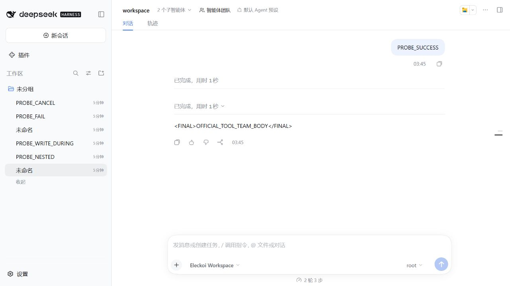
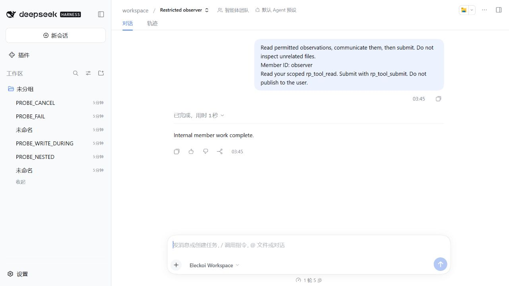

# 团队工具公开 API 接入：实现与实测报告

日期：2026-10-07。输入任务：《以团队工具为中心的 ElecKoi 插件接入说明》。本次实际开发并运行了专门的两成员团队工具，而不是只阅读测试或推断接口能力。

## 结论

**普通团队协作能够不依赖 ElecKoi 的 `prepare`、`afterSave`、`prepareRestore` 三个插件回调完成。** 本次已验证：真实输入和资料读取、两名原生成员、权限筛选、原生消息、结果汇总、正常根会话正文、插件私有状态、取消／失败、多轮、删除／重生成、独立进程重启及插件停用／卸载／再安装。

**正式聊天变量的保存与历史一致性仍有一个具体卡点。** `replaceVariableState` 确实能保存数据库，不能再称为“没有变量存储接口”。但是生成中调用会使原生保存出现基值冲突；保存后调用不能补入该轮状态快照，删除正文后恢复旧值。

因此，团队分工和工具能力继续采用 DSH + 现有产品接口；需要向官方讨论的是“工具计算出的产品变量如何纳入正式 turn 保存及历史恢复”，而不是请求宿主再实现一套团队系统。

## 1. 验证对象和边界

| 项目 | 本次实物 |
| --- | --- |
| ElecKoi | 官方源码 `d4b6bb949771693cd357ddd535ead22f4e835774`，Desktop 0.2.8 |
| DSH | 安装包 `0.2.0-rc.2`；目标源码标识 `c1b47e41fcd54d20a0f061df28683bfc29ee24e5`，以该宿主锁文件和官方发布包运行 |
| 新样例 | `@rp-team/official-tool-team@0.1.0`，独立可安装 bundle |
| 现有仓库 | RP Agent Team 0.4.0，原 HEAD `ee6d43a90aaa534e6a635df97b0fd4dd3856db6b`；现有运行链没有被替换 |
| 宿主修改 | 未应用 `host-patch`，未改宿主业务源码；7个关键源码／锁文件与官方下载归档逐项哈希相同 |
| 模型 | 本地确定性 `LlmAdapter`，真实 Agent Loop；没有外部模型网络请求，没有付费调用 |
| 数据 | 独立 `DSH_HOME`、Session 根、SQLite、资料与工作目录；只有新建合成角色和测试对话 |
| 回调 | 样例源码不引用或注入 `eleckoiConversationLifecycle`；未注册三个回调。这个结论有源码约束测试，不是捏造运行时 hook 计数 |

原文给出的 `080fc027c44d5ad2f720fa312513acee3efe63d5` 在核对时无法从官方 GitHub commit页面和 API取得。本次固定到能实际下载并运行的 d4b6bb提交，不冒称是对不可取得版本的验收，也不覆盖后续 main。

官方宿主仍在内部使用自身聊天生命周期服务。这与**插件没有注册三个回调**是两件事；本次没有删除宿主内部保存流程。

## 2. 交付文件

- `examples/official-tool-team/index.mjs`：普通 Cordis bundle入口，公开服务注入。
- `examples/official-tool-team/runtime.mjs`：自建团队工具、原生成员、资料和工具权限、通信、结果汇总、取消和保存观测。
- `examples/official-tool-team/journal.mjs`：插件自有记录；按当前正式输出 ID计算有效私有状态。
- `examples/official-tool-team/cordis.patch.yml`：插件包自带注册层，不是 ElecKoi 源码补丁。
- `examples/official-tool-team/README.zh-CN.md`：输入输出合同、绑定配置、运行方式和明确限制。
- `scripts/verify-official-tool-team.mjs`：真实目标宿主的隔离执行夹具，使用官方插件管理器安装 `.tgz`。
- `tests/official-tool-team.test.mjs`：权限字段、稳定输出身份、失败状态和插件文件持久化测试。
- `MINIMAL_REPRO.zh-CN.md`：产品变量写入时机的独立复现说明，供维护者核对。

包路径：`C:/Users/O4/Desktop/agent rp team/output/official-host-tools-20261007/delivery/rp-team-official-tool-team-0.1.0.tgz`。

包 SHA-256：`6e5269c51e440979c48b21190bbd04b90f58237f465e693486050799380dd06b`。

## 3. 真实调用链与资料所有权

```text
公开 Conversations.preparePrompt
  → 原生 sessionController.prompt
  → agent/pre-step：捕获真实用户消息和原生 turn
  → 根模型实际调用 rp_team_run
  → agentTeams.createTask / claim / spawnTeammate
  → 每名成员的真实 child Session、Agent Loop和 scoped工具
  → rp_tool_read：Conversations.authorState + details
  → rp_tool_send：agentTeams.sendMessage
  → rp_tool_submit：插件暂存结果与可写键验证
  → 等待并排空成员 → 汇总候选
  → 根模型通过普通聊天继续输出
  → 原生 Session保存 → 产品保存
  → 公开 Conversations.changes generation通知
  → 插件将私有结果标为已提交
```

这里调用 `preparePrompt` 是正式产品接口操作，不是注册 `prepare` 回调。

产品资料通过 `eleckoiConversationsApi.authorState` 和 `details`取得；夹具通过公开 Character／CharacterConfiguration服务建立资料和变量。插件没有导入 SQLite、Repository或 `eleckoiProductData`，没有手工写 Session 日志。

权限由插件负责：角色／变量字段按路径筛选，设定按稳定条目 ID筛选；发送对象和可写键由配置控制。成员启动使用原生 `context: fresh`，继承的全局工具被限制，并另加执行前拒绝。实际请求中授权设定 `PUBLIC_SETTING_BODY` 存在，隐藏设定／变量 `HIDDEN_WORLD_SECRET` 不存在。夹具特意调用被隐藏的 `eleckoi_glob_variables`，真实工具结果返回拒绝；不是只检查工具列表。

最终注册使用 `createScope(pluginCtx, scopeOf(agent.ctx))`：权限与工具带有原生成员的作用域身份，但由插件拥有。直接把外部注册长期放进 Agent 自己的生命周期会在重装检查中留下重复注册；这个插件侧问题已经修正，最终停用／卸载／重装通过。

## 4. 文档要求逐项核对

| 文档要求 | 实际结果 | 证据 |
| --- | --- | --- |
| 固定实际版本 | 完成；原 SHA不可取得，明确替换基线 | 下载归档、锁文件、`official-source-integrity.json` |
| 定义专门工具合同 | 完成 | 样例 README、`executeTeam`、成员工具定义 |
| 不注册三个回调 | 完成 | 样例入口和 `installed example depends on public APIs…` 测试 |
| 本轮输入、角色、设定、当前变量 | 完成，非空实际内容验证 | 真实 `rp_tool_read` 结果进入下一次模型请求 |
| 两成员使用自己的工具、交流、汇总 | 完成 | 原生团队名单、mailbox结果、真实 `tool/result` 与候选 |
| 正文进入正常聊天 | 完成；成功测试仅一条正文 | 根 Session `assistant/message`，官方 UI正文 |
| 插件结果保存、重读及重启 | 完成 | journal、`state()`、独立进程 `reopen-results.json` |
| 停止及成员失败 | 完成；排空子执行，私有结果不生效 | `cancelled/failed` 记录，有效私有状态为空 |
| 删除与重生成 | 完成，按有效输出 ID恢复私有状态 | 第二轮删除后恢复首轮；首轮重生成建立新 run |
| 嵌套及恢复会话权限 | 完成于该两成员样例 | nested/resumed真实请求，恢复闭合 run不能修改结果 |
| 变量读取→计算→保存→重读 | 写入本身完成；正式保存和历史一致性失败已复现 | 两项写入时机测试，见下节 |
| 官方名单可打开成员会话 | 完成于原生 DSH UI | 官方团队面板、成员 Session／轨迹截图 |
| 完整试演／跨成员汇总视图 | 本次不实现 | 原文要求先完成普通团队工具；不作为已验证能力 |

最终包运行9项场景，进行了72次本地真实模型请求；单元测试6项通过。第9项包括停用、卸载、重新安装及资料保留。独立新进程另外通过重启检查，没有发出模型请求。

两项产品写入场景是**预期限制的成功复现**，不意味着产品一致性需求已通过。

## 5. 写入时机实测

### 5.1 在团队工具内部直接替换当前变量

初始产品变量 `{score:1, hidden:"HIDDEN_WORLD_SECRET"}`。观察成员只读 score，计算 `score=2`；汇总时保留其他键，再调用 `replaceVariableState`。

实际结果：写入返回成功，`authorState`重新读取为2；根 Session 已产生最终正文；随后产品保存报：

> 生成期间聊天变量已被其他操作修改，未覆盖当前变量。

插件标为 `product-save-failed`，没有把私有修改计入有效状态；数据库中的独立写入2未自动撤销。这不是“模型失败所以没有正文”，而是**原生日志和产品保存发生了不同结果**。

对应官方调用点：

- `packages/dsh-product-api/src/index.ts:590`：`replaceVariableState`立即调用产品数据写入，发布 edited通知。
- `packages/dsh-product-data/src/index.ts:519`：`replaceConversationVariableState`进入 current对象写入。
- `packages/dsh-product-data/src/index.ts:605`：`commitConversationRuntime`比较生成基值；不一致时620行报错。
- `packages/dsh-client-roleplay/src/host/session-runtime.mjs:256`：先 flush原生 Session，随后258行执行产品提交；失败通过 generation通知报告。

API注释“生成期间拒绝修改”与这个实际行为不同；本次同时有源码和运行证据。

### 5.2 正式保存后独立替换当前变量

正常完成一轮，产品快照中 score为1。通过公开 API把当前值替换为9。

实际结果：当前读回9；`variableTimeline.floors`前后完全相同，楼层状态仍为1。删除该正文后，Host恢复检查点值1，插件对应私有结果也退出有效状态。夹具随后**又明确写入一次9**用于独立进程持久化测试；重启能读到9，不代表被删除的楼层保存过9。

`variableTimeline`读取路径位于官方 `packages/dsh-product-api/src/index.ts:560`。恢复测试调用公开 `deleteMessagesFrom`，不是手工改数据库或日志。

### 5.3 提出的最小问题

团队工具已能计算、校验并保存变量。现在需要一种**公开且稳定的用法**，把经过校验的工具变量结果交给当前正式生成，在原生保存时写入 current及该轮检查点，同时保留基值冲突、取消、失败和回退语义。

不预定 API最终名称，不要求新建数据库表、团队调度、成员权限或专属页面。若维护者确认已有公开能力可以改变本轮 product variable working state，应给出用法，我们可复验并删掉新增接口请求。当前 `replaceVariableState`的两个时机都不能满足上述“与本轮一起提交”的语义。

## 6. 不应夸大的地方

1. **最小样例不是完整 0.4.0迁移。** 既有 V2 runtime、记忆、预算、作者参数、Trial和融合轨迹仍保留原来的宿主接入。本次没有破坏真实工作区或承诺它们已经无补丁运行。
2. 根模型正常交付候选已经验证；任意发布者的候选被机器强制原样交付、根调度完全不调用模型等较强要求没有验证。这个工具样例会产生真实根模型调用。
3. 私有结果使用公开变更通知和有效原生输出身份，足够完成本样例的成功、删除、失败和重启规则；它不是产品与插件文件的共同事务。
4. 通知缺少 durable operation/run回执，进程恰好在保存与插件记账之间崩溃时，本样例保留 `unknown`，不擅自重跑或补提交。只验证正常独立进程重启，不声称所有崩溃点已经恢复。
5. 并未证明任意 preset、附件、压缩、所有历史节点和所有工具类型的权限隔离。本次真实请求覆盖授权字段、必读／always设定、被禁原生变量工具、嵌套与恢复成员。
6. UI实测是官方原生 DSH团队组件。在直接 Node/web启动方式中，完整 ElecKoi Client Shell因缺少桌面资源装载环境未激活；测试 profile关闭该 shell后，名单、任务板、成员导航和轨迹已验证。没有修改 shell源码，也没有宣称真实 Electron窗口验收通过。
7. official Agent Team服务仍是实验性 profile，需要宿主启用。包安装本身不能替代这项环境条件。

## 7. 证据及运行命令

最终数据位于：

`C:/Users/O4/Desktop/agent rp team/output/official-host-tools-20261007/data-final-04/`

- `results.json`：9项场景、72次实际请求、成员／run清单、安装包记录、加载文件哈希。
- `reopen-results.json`：全新进程私有状态和产品当前值复读，0次模型请求。
- `official-source-integrity.json`位于上一级：7个关键宿主文件与下载归档一致。
- `unit-tests-final.log`位于上一级：6项测试结果。
- 附图和简要可分享证据位于本文同目录 `evidence/`；完整请求证据保留在上述隔离目录，仅含合成数据。

最终安装包重启后的官方团队名单与任务板：



从该名单点击观察成员，打开其原生轨迹：



执行示例见样例 README。命令实际退出码均为0：目标单元测试、Node语法检查、干净宿主 workspace-runtime构建、Node SQLite重建、原生 renderer构建、最终 `.tgz`安装运行及独立进程复读。

构建成功不代替 Electron验收；此前开发中未通过的试验目录保留供诊断，**不作为最终通过证据**。

## 8. 接下来采用的方向

本次已经交付“先做团队专门工具、用官方事件和产品数据接口验证”的闭环。普通团队能力不再以这三个聊天回调为前提，也不要求官方合并累计 host patch。

保留一个独立、可复现的产品变量保存问题交给维护者讨论。完整0.4.0迁移需要另行按功能验收，不能凭此最小样例自动删除现有完整运行链。官方三个入口的删除安排由官方决定；本次没有提交 PR或发出官方消息，也没有升级实际聊天 profile。
